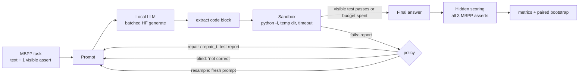

# code-repair-agent

An execute-and-repair coding agent for small local LLMs, and an honest measurement of
whether the "agent" part helps. The model writes a Python function, a sandbox runs it
against a test, and the agent can feed the test report back for another try. The
question: **with the same budget of generations, does tool feedback beat simply sampling
again?**

Measured on the 500 tasks of the MBPP test split with Qwen2.5-1.5B-Instruct running
locally (RTX 4060, fp16).

## Protocol

- **Visible vs hidden tests.** The agent only ever sees the *first* MBPP assertion of a
  task (it fixes the function name and signature) and may stop as soon as that one passes.
  The final answer is scored on *all three* MBPP assertions. A policy that games the
  visible test is therefore caught (`overfit` column = share of visible passes that fail
  the hidden tests).
- **Same budget.** Every multi-step policy may use up to k = 4 generations per task.

| policy | what it does |
|---|---|
| `single` | one greedy answer, no tool use (baseline) |
| `resample` | greedy answer, then up to 3 fresh samples (T = 0.8), keep the first that passes the visible test |
| `repair` | greedy answer, then up to 3 greedy repair turns with the sandbox report (failed assertion, value actually returned, exception) |
| `repair_t` | same as `repair`, but repair turns are sampled (T = 0.8) |
| `blind` | ablation: same turns as `repair`, but the model is only told "your code is not correct" |

The sandbox runs each candidate in a fresh `python -I` process, in an empty temp directory,
with a minimal environment and a 5 s timeout, and returns a structured report
(`syntax` / `import` / `timeout` / `wrong_answer` with the actual value / `runtime_error`).

## Results

**Findings (Qwen2.5-1.5B, k = 4):**

- Sampling again is the best use of the budget: `resample` lifts the hidden pass rate from
  0.428 to 0.534 (+10.6 points, 95% CI [+8.0, +13.2]).
- Feeding the sandbox report back helps much less: greedy `repair` +3.0 points, sampled
  `repair_t` +4.2 points, and `repair_t` stays 6.4 points below `resample`.
- The test report itself adds nothing measurable at this size: `repair` vs the `blind`
  ablation is -1.6 points (CI [-4.0, +0.8]).
- Greedy repair resubmits an identical program in 57.5% of tasks (repeat rate); sampling
  the repair turns drops that to 12.2%.
- All multi-step policies overfit the visible test a little more than `single`
  (overfit 0.16-0.18 vs 0.15).

### Qwen/Qwen2.5-1.5B-Instruct (500 MBPP tasks)

| policy | hidden pass | visible pass | first-try pass | overfit | gens/task | repeat rate | new tokens/task |
|---|---|---|---|---|---|---|---|
| single | 0.428 | 0.502 | 0.428 | 0.147 | 1.00 | 0.000 | 113 |
| resample | 0.534 | 0.652 | 0.428 | 0.181 | 2.29 | 0.005 | 298 |
| repair | 0.458 | 0.544 | 0.418 | 0.158 | 2.46 | 0.575 | 350 |
| repair_t | 0.470 | 0.570 | 0.436 | 0.175 | 2.38 | 0.122 | 377 |
| blind | 0.474 | 0.564 | 0.436 | 0.160 | 2.38 | 0.471 | 310 |

Paired differences in hidden pass rate (95% bootstrap CI):

- repair - single: +0.030 [+0.004, +0.056]
- resample - single: +0.106 [+0.080, +0.132]
- repair_t - single: +0.042 [+0.018, +0.068]
- repair_t - resample: -0.064 [-0.094, -0.034]
- repair - blind: -0.016 [-0.040, +0.008]

First-attempt failure types (single policy):

import: 16, pass: 251, runtime_error: 48, wrong_answer: 185

## Architecture



Code: `src/repairagent/` — `sandbox.py` (process isolation + structured test report),
`agent.py` (policies, run in lock-step over batches of tasks), `llm.py` (batched Hugging
Face chat backend + a scripted fake used in tests), `metrics.py` (rates, paired
bootstrap), `cli.py`.

## How to run

```bash
pip install -e ".[dev]"          # core + tests (no GPU needed)
pytest -q
repairagent smoke --limit 20     # scripted end-to-end run of all policies, no model

pip install -e ".[llm]"          # torch + transformers
repairagent run --model Qwen/Qwen2.5-1.5B-Instruct --out reports/runs/qwen1.5b.jsonl
repairagent report reports/runs/*.jsonl --out reports/results.md
```

`run` options: `--limit N` tasks, `--policies single repair ...`, `--k 4`,
`--batch-size 48`, `--max-new-tokens 320`. Per-task rows are written as JSONL
(`reports/runs/`), so the table can be rebuilt without a GPU (CI does this).

## Limitations

- One small model (Qwen2.5-1.5B-Instruct); larger models are known to use feedback
  better, so the conclusions are about this size class. A 0.5B run is not included yet.
- MBPP has three short assertions per task; "hidden" tests are weak and some MBPP
  reference tests are themselves questionable. The overfit rate is a lower bound.
- Batched fp16 generation with padding is not bit-exact across runs, so the greedy first
  attempt differs slightly between policies (first-try pass 0.418-0.436 vs 0.428).
- One seed per policy; the CIs cover task sampling, not decoding randomness.
- The sandbox is a convenience, not a security boundary: run untrusted code in a
  container or VM without network access.
- Greedy repair turns are deterministic given the conversation, which is exactly why the
  model can resubmit the same program (see the repeat rate).

## En bref (FR)

Agent de code « générer → exécuter → corriger » avec des petits LLM locaux (Qwen2.5-1.5B) sur les 500 tâches de test de MBPP. L'agent ne voit qu'un test sur trois et
peut s'arrêter dès qu'il passe ; la réponse finale est notée sur les trois tests, ce qui
mesure aussi le sur-apprentissage du test visible. À budget égal (4 générations), on
compare une réponse unique, le ré-échantillonnage, la correction avec le rapport
d'exécution du sandbox (greedy ou échantillonnée) et une correction « à l'aveugle ».
Résultats mesurés, intervalles de confiance par bootstrap apparié, tests pytest et CI
GitHub Actions.

## License

MIT
